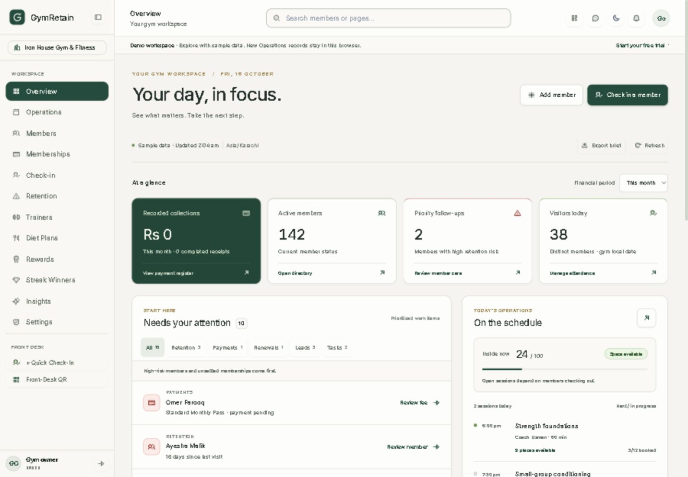

# GymRetain dashboard: HCI and UX implementation

This revision turns the overview into a daily work surface for an independent gym owner. It retains the existing ivory, forest, brass and semantic status palette. The goal is to make the next useful action easier to find, explain every number, and keep incomplete data from looking reassuring.

[Full desktop preview](previews/dashboard-hci-full.png) · [Mobile preview](previews/dashboard-hci-mobile.png)



## 1. Research and inspiration

Reviewed on 16 October 2026. These observations concern public product pages and their published examples, not authenticated product access, independent performance testing or feature parity.

| Reference | Observed emphasis | Adaptation in GymRetain |
| --- | --- | --- |
| [Gymdesk](https://gymdesk.com/) | Everyday administration, attendance, payments, bookings and business reporting. | A compact daily overview, linked metrics, a schedule beside the work queue and labelled financial periods. |
| [Zen Planner](https://www.zenplanner.com/) | Organized operations, personal member journeys and community participation. | Member-specific follow-ups, reasons for reviewing a member, visible check-in streaks and clear staff workflows. |
| [PushPress](https://www.pushpress.com/) | Connected membership management, lead conversion, scheduling and engagement. | A pipeline linked to its actual stages, booking availability and contextual routes into retention and payments. |

These are our design interpretations of the references. Branding, proprietary layouts, imagery and copy were not copied. No reference site's automated billing, workout platform, member app or marketing automation is implied to be implemented here.

## 2. What changed and why

The earlier dashboard devoted substantial space to an aspirational headline, an all-time collections card and a large occupancy graphic. Important work appeared below those elements, and some links opened a whole section without preserving the selected member or category.

The new hierarchy is:

1. **Context and frequent actions:** gym name, local date, a short heading, Add member and Check in a member.
2. **System status:** refresh state, last refresh attempt in the gym timezone, sample-data identification, manual refresh and export.
3. **At a glance:** four linked metrics with explicit definitions. Management sees collections; other staff see current floor count instead.
4. **Needs your attention:** prioritized reviews and due work, with category counts and direct actions.
5. **Today's operations:** occupancy, booking availability, coach names and the schedule, beside the attention queue on desktop.
6. **Attendance and recorded cash flow:** trends and financial context below immediate operational work.
7. **Pipeline and member momentum:** a concise growth view and recognition of member consistency.

This is a prioritization hypothesis, not a measured claim that every gym will perform tasks faster. Pilot testing should validate the ordering and vocabulary.

## 3. HCI principles applied

The implementation uses [Nielsen's usability heuristics](https://www.nngroup.com/articles/ten-usability-heuristics/) as a review framework: explain loading and failures; use familiar terms; provide contextual actions; support task reversal; keep the first view concise; and put additional detail behind deliberate expansion. Explicit periods and member-specific routes reduce the need to remember context between screens.

The following maps the implementation to [Shneiderman's eight golden rules](https://www.cs.umd.edu/users/ben/goldenrules.html):

| Rule | Concrete implementation |
| --- | --- |
| Consistency | Shared controls, status colors, panel boundaries and terminology. |
| Universal usability | Responsive layouts, native controls and keyboard-accessible table details. |
| Informative feedback | Loading, partial refresh, task success and save-error messages. |
| Closure | A completed task leaves the queue and produces confirmation. |
| Error prevention | Explicit financial definitions; busy-state protection; versioned task writes. |
| Reversal | Undo reopens the most recently completed dashboard task. |
| User control | Manual filters, reporting periods, refresh and expansion. |
| Reduced memory load | Names, reasons, dates and actions appear together. |

Color reinforces the written state: pale red for urgent review, yellow for approaching or overdue work, and green for positive availability or successful completion. Color is not the only indicator. Forest remains the primary action and collections color; brass supports the dark theme.

## 4. Main interactions

### Check-in and member enrollment

Check in a member opens the existing check-in tool directly on the dashboard. A successful check-in refreshes the overview and attendance. Add member opens the existing member form through `/members?new=1`. Neither action records a visit or creates a member merely by opening the tool.

The check-in tool now uses the shared labelled dialog with Escape dismissal, focus trapping, focus restoration, a labelled member field and a 44px close control. Opening it clears the previous result. Sample-member shortcuts appear only in demo mode and prefill the identifier; Confirm Check-In is still required. Busy-state protection prevents repeat submissions while a request is pending. Demo success feedback is explicitly identified as a sample result.

### Attention queue

The count represents **work items**, not distinct members. A member can legitimately have both a retention review and a pending membership review.

The queue includes:

- Retention records, highest risk scores first before final priority grouping.
- Memberships explicitly marked PENDING_PAYMENT.
- ACTIVE memberships ending from today through seven calendar days ahead.
- Open lead follow-ups due today or earlier, excluding Joined and Lost.
- Incomplete tasks due today or earlier.

Priority zero contains high-risk retention reviews and pending memberships. Priority one contains renewals, overdue lead follow-ups, high-priority tasks and overdue tasks. Other due work and medium-risk reviews follow. Within a priority, categories and titles provide deterministic ordering. This is a simple application rule, not an AI recommendation or debt assessment.

Filters show All, Retention, Payments, Renewals, Leads and Tasks for management. Only All and Retention appear in the non-management queue. Four items are visible initially; Show all expands the selected category. Changing category resets that expansion. Empty and unavailable states use different messages.

### Complete and undo a task

Complete sends the existing versioned Operations update and waits for the saved result. A failed request leaves the task present and displays the error. A successful update removes the completed task from due work and displays an Undo action. Undo sends a new saved update with `completed: false`; it does not merely change the visual state. Another team member's edit can cause a version conflict, which requires refresh before retrying.

Undo concerns the latest successful completion in the current dashboard session. It is not an account-wide history or a replacement for the full checklist.

### Contextual navigation

| Dashboard action | Destination behavior |
| --- | --- |
| Priority follow-ups metric | Retention filtered to HIGH risk. |
| Review member | Retention searched by that member's code. |
| Review fee | Pending memberships filtered and searched for that member. |
| Review renewal | Active memberships searched for that member. |
| Collections / payment-register link | Payment Records tab. |
| Record payment | Payment Records tab with the existing entry form open. |
| Open enquiry | Lead pipeline searched by the lead's name. |
| Pipeline stage | Lead pipeline filtered to the selected stage, with Clear stage filter visible. |
| Schedule | Sessions on the dashboard's gym-local date. |
| Member momentum name | Member directory searched by member code. |

The destination remains authoritative for validation, permissions and mutation. A dashboard link never silently records a payment or sends a message.

## 5. Metric definitions and trust

| Metric | Definition and source | Important limits |
| --- | --- | --- |
| Recorded collections | Completed PKR payment rows in the selected window, summed in paisa. | Not recurring revenue, forecast revenue or reconciled accounting. |
| Active members | Current active-member count from the overview API. | A member count, not an active-subscription count. |
| Priority follow-ups | HIGH-risk records in the returned retention queue. | Risk is guidance for staff judgment. |
| Visitors today | Distinct members checked in on the gym's local date. | Different from total visits, which may include repeat entries. |
| Inside now | Open attendance sessions from the overview API. | Missed check-outs affect the count. |
| Recorded expenses | Expense entries whose date falls in the financial window. | Depends on what staff have entered. |
| Recorded cash difference | Recorded collections minus recorded expenses for the same window. | Explicitly not profit or an outstanding balance. |
| Pipeline stages | Counts of saved leads by current stage. | Joined is a CRM state, not automatic enrollment or payment. |

The default financial period is **This month**, from the first day of the current gym-local month through today. Last month covers the entire previous calendar month. All time includes valid recorded dates through today. Future dates are excluded. Payment date uses `paidAt`, falling back to `createdAt` for legacy completed records without a payment date. Invalid dates, non-PKR currencies, non-completed statuses and invalid/negative amounts are excluded. Exclusion does not reconcile a separate refund ledger.

The financial selector changes only financial summaries and their export values. Today's metrics remain labelled today. Attendance has its own 7D / 14D / 30D selector. The chart average is explicitly over reported days; missing API days are not invented as zeros.

The sample payment fixtures contain historical dates. A current month with no matching sample receipts correctly shows zero, even if All time has recorded collections. No fresh payments or growth percentages are fabricated to make the dashboard appear active.

## 6. Loading, errors and refresh

Overview, Operations, Collections, Retention and Memberships are requested independently with `Promise.allSettled`. Failed sections clear their previous data and show unavailable values. Other sections remain usable. An alert identifies affected sources and offers Retry. The attention queue excludes unavailable sources rather than implying the full business has no work.

Attendance has a separate loading/error state and a dedicated retry. Switching its period fetches attendance without reloading every other business source. Manual dashboard refresh requests both the overview sources and attendance. Request guards prevent older responses from overwriting a newer selection.

The timestamp describes a completed refresh attempt; a partial attempt is labelled Partially refreshed. It is not a claim of real-time synchronization. There is no automatic polling or background messaging in this revision. The sample banner remains visible for guests.

## 7. Accessibility and responsive behavior

Native buttons, selects, links, details and table semantics are used. Filter selection is exposed through `aria-pressed`; loading regions use `aria-busy`; task confirmations use status messages and errors use alerts. The attendance visualization has a descriptive label, and View daily figures exposes exact values in a keyboard-accessible table rather than relying on mouse hover.

Frequent mobile actions, row actions and category filters target a 44px height. The implementation considers [W3C's target-size guidance](https://www.w3.org/WAI/WCAG22/Understanding/target-size-minimum.html), but does not claim a WCAG conformance audit. Links within text and legacy tools still need a full accessibility review.

Desktop uses a four-metric row and two-column work surfaces. Mobile uses two metric columns and single-column panels, preserving readable priority ordering. Filter groups have their own horizontal scrolling. Long names and tasks wrap. Reduced-motion preference removes card movement. Existing shared focus treatments, themes and skip navigation remain available.

## 8. Implementation map

| File | Responsibility |
| --- | --- |
| `frontend/src/app/page.tsx` | Dashboard route. |
| `frontend/src/components/dashboard/DashboardWorkspace.tsx` | Data loading, dashboard layout, interactions, check-in entry and export. |
| `frontend/src/lib/dashboard.ts` | Pure period, collection/expense and attention-priority calculations. |
| `frontend/src/app/globals.css` | Scoped `desk-` dashboard styling and responsive rules. |
| `frontend/src/app/subscriptions/page.tsx` | Financial deep-link tab, status, search and form handling. |
| `frontend/src/app/retention/page.tsx` | Retention search/risk URL handling. |
| `frontend/src/components/AtRiskMembersTable.tsx` | Initial search/risk selection while preserving manual filters. |
| `frontend/src/components/QuickCheckInModal.tsx` | Accessible shared-dialog entry, explicit confirmation and demo separation. |
| `frontend/src/components/ui/Modal.tsx` | Shared close control touch target. |
| `frontend/src/app/operations/page.tsx` | Lead search/stage and schedule-date URL handling. |
| `frontend/tests/dashboard.test.cjs` | Period boundaries, money/date filtering, queue priorities and role filtering. |

No new backend routes, schema migrations, dependencies or external accounts are required for this dashboard revision. Existing authorization and Operations persistence remain responsible for backend enforcement. Hiding management panels is a usability choice, not a substitute for server authorization.

## 9. Local commands and verification

From `frontend`:

```powershell
npm test
npm run build
npm run dev
```

The local development script uses port 3001. Stop a running development server before building against the same `.next` directory. The project also produces a standalone deployment artifact; deployment configuration and live services still require the production work documented in `PREMIUM_WORKSPACE.md`.

Automated regression coverage includes previous-year/leap-month boundaries, timezone crossing at midnight, paisa precision, future/failed/currency exclusions, missing expense sources, expiry versus pending-payment semantics, exclusion of completed/future work and non-management queue filtering. Existing API and Operations regressions remain part of `npm test`.

Browser review should verify period changes, every queue category, task completion and Undo, member-specific destinations, pipeline-stage clearing, schedule date, daily figures, check-in opening/closing, narrow-screen containment, light/dark themes and CSV download. Verification results for this revision are recorded below after execution.

## 10. Next usability validation

Pilot with owners and front-desk staff using realistic records. Ask them to find a member needing attention, complete and undo a task, distinguish visitors from check-ins, identify the date range behind collections, locate a full session and recover from one unavailable source. Observe task completion, navigation errors, time spent finding actions and misunderstandings of financial labels. Set quantitative targets after collecting a baseline rather than claiming unmeasured gains.

Production checkout, automated delivery, account recovery, deployment security and database-level end-to-end verification remain separate launch requirements. This dashboard revision does not resolve those infrastructure or provider dependencies.

## 11. Verification record

- Frontend regression suite: **19 tests passed**. This includes five new dashboard tests in addition to the previous API and Operations coverage.
- TypeScript validation passed. The final production build passed compilation, type validation and generation of all 17 static pages, including the affected dashboard, retention, Operations and membership routes.
- Browser: task completion reduced the due count and Undo restored it. Demo records were restored after the test.
- Browser: All time showed four completed sample receipts totaling Rs 76,000; Last month showed two totaling Rs 11,500. The current month's zero receipts were not replaced with invented values.
- Browser: a selected member opened a retention queue containing only that member; a pending membership opened the correct member/status combination; a trial-stage link opened only that stage with a visible clearing action.
- Browser: the attendance details contained 14 rows for 14D and seven rows after selecting 7D.
- Final built-preview keyboard check: the member field received initial focus and Escape restored focus to Check in a member. Sample selection did not submit a visit. Record payment opened the existing entry form without submitting it.
- Browser: CSV download succeeded. Its rows retained the selected financial window, source date range, sample-data label and distinction between collections and profit.
- Browser: mobile document width measured 384px at a 390px viewport and 314px at a 320px viewport. Category controls measured 44px tall on mobile. Light and dark themes were inspected.
- Visual review caught and fixed an old global header selector that made a primary button transparent. Header styling now targets the application navigation rather than every page header.

No real member visit, payment or external message was submitted in browser verification. Source failures are covered by API regressions and explicit dashboard states; live outage injection, a screen-reader audit and production multi-tenant end-to-end tests remain outstanding.

## 12. Reference-inspired visual revision

The follow-up visual review examined the public homepages of [Gymdesk](https://gymdesk.com/), [Zen Planner](https://www.zenplanner.com/) and [PushPress](https://www.pushpress.com/). These were public marketing pages; no authenticated competitor workspace was inspected. The implementation adapts their visual hierarchy to a working management dashboard rather than reproducing their branding or assets.

| Reference pattern | GymRetain adaptation |
| --- | --- |
| Gymdesk's dark opening surface and prominent contrasting action | Forest dashboard header with a mint Check in a member action and a secondary outlined Add member action |
| Zen Planner's bold typography and framed dark navigation | Heavier Plus Jakarta Sans headings, a forest navigation rail and a clearly filled active destination |
| PushPress's bright space, strong type and contrasting product navigation | Ivory workspace, white bordered panels, bold metric figures and a distinct navigation rail |

The shared navigation now carries the forest treatment across application pages. Dashboard cards use restrained shadows, explicit boundaries and consistent corner radii. The attention filters have count chips, action arrows have visible hit areas, and metric icon tiles use semantic sage and red accents. Existing yellow warning states remain available through the shared status palette. Color supports the existing text labels and icons rather than replacing them.

The hero uses subtle CSS arcs instead of a photograph so operational content stays legible and loads without an additional image request. Its primary action remains close to the heading on narrow screens. The visual revision changes CSS and navigation class hooks only; business calculations, APIs, task storage, permissions and destinations retain their existing behavior.

Responsive review covered 1440px desktop, 390px mobile and 320px mobile widths. The mobile document remained within the viewport (384px and 314px respectively), check-in opened with focus in the member field, mobile navigation opened and closed, and both light and dark themes were inspected. The heading weight was checked in the rendered browser after resolving a competing global selector.

Validation after the visual revision: all 19 frontend regressions passed, and the production build passed compilation, lint/type validation and generation of all 17 static pages. No backend files were changed.

Updated visual previews:

- [Desktop dashboard](previews/dashboard-reference-ui-desktop.png)
- [Full dashboard](previews/dashboard-reference-ui-full.png)
- [Mobile dashboard](previews/dashboard-reference-ui-mobile.png)
