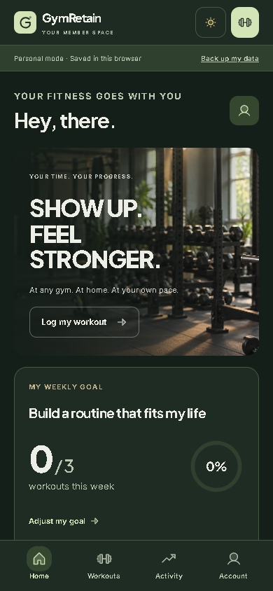
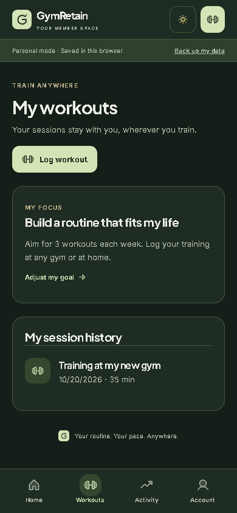

# Personal member mode

Gym passes are available for connected gym members from the header, Home, and Account. `/portal/pass` uses the existing signed rotating QR endpoint; preview shows a non-scannable placeholder. Personal mode offers workout logging in the header and does not issue a pass. Opening the pass URL in personal mode explains the optional gym connection. Owner check-in and backend security remain unchanged.

## Use without a participating gym

Open `/portal` without a member session to start a personal tracker. An existing gym member can choose **Take my training into personal mode** in Account. This copies their loaded workouts, personal records, measurements, name, and goals into browser storage, without copying payment, gym, or trainer records. Repeating the transfer merges entry IDs instead of duplicating history. Preview starts an empty tracker rather than copying sample records.

Personal mode provides workout logging and history, records, measurements, weekly goals, a profile, and JSON backup/restore. It uses browser storage independently of the member API or gym owner subscription. Weekly counts come from logged workouts in the browser's local timezone. Connected-gym classes, rewards, memberships, and messaging are optional and are not presented as personal features.

## Storage limits

Personal data is saved in this browser, not synced to a cloud account. Export a backup before clearing browser storage or changing devices. Import validates the backup before replacing current data and requires a confirmation in the UI. Invalid imports and invalid writes leave existing storage intact. Storage errors are reported rather than displayed as successful saves.

The loaded tracker can save entries without contacting the server. Loading the application on a fresh device still requires the website to be reachable; this change does not promise a fully cached offline application.

Switching back to a gym uses the existing OTP login and tenant-scoped backend. Personal mode does not alter staff credentials or server-side authorization, and real API failures do not silently become personal-mode successes.

## Checks

Frontend tests cover persistent local entries, goal edits, backup restore, invalid writes/imports, repeated history transfer, unsupported connected-gym actions, and switching the client transport back to authenticated requests. Production build includes TypeScript and lint checks.

All 32 frontend tests, TypeScript, ESLint, and the production build passed. REA browser evidence `ev_54636d2cb6af23a1a132d3cac146c49c1d6913a53892c95f8edbf5e51cfa88b5` verifies a fresh personal home, logging a workout without an account, preserving it after a full navigation/reload, and accessing backup controls. All actions completed with no page errors. At that revision, the pass URL returned HTTP 404. Pass access was subsequently restored for connected gym accounts at the user’s request.

Restored-pass verification: REA evidence `ev_71e64752bb4832da58ab73f6901439cf0bd53978f0bf7bfadfc5f3bd549fa716` confirms Account opens the pass preview and personal mode instead presents the gym-connection prompt with its workout shortcut intact. All actions completed without page errors. Production build passed. Live signed-QR issuance still requires the gym backend and database; the preview does not issue a usable code.
